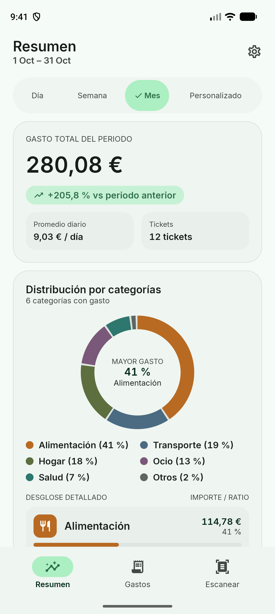
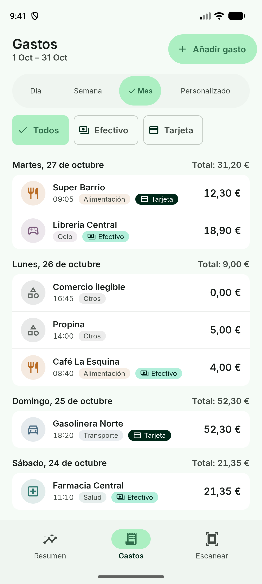
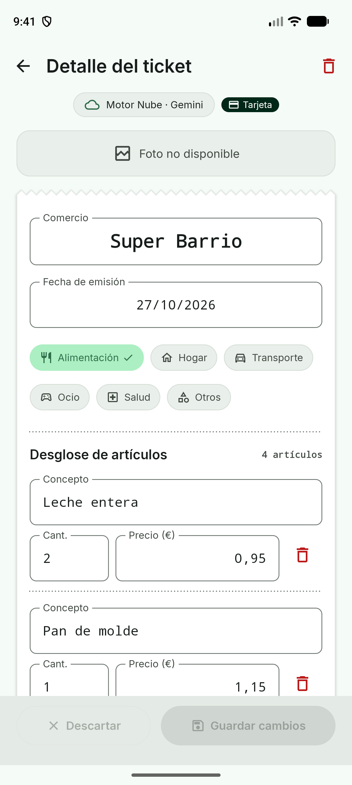
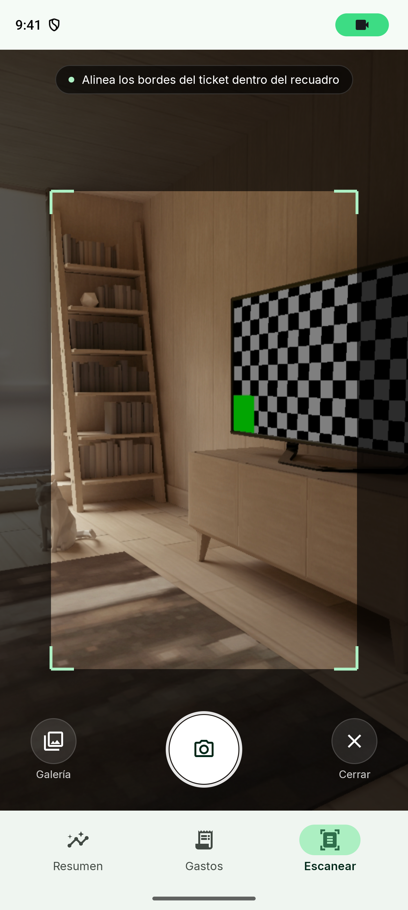
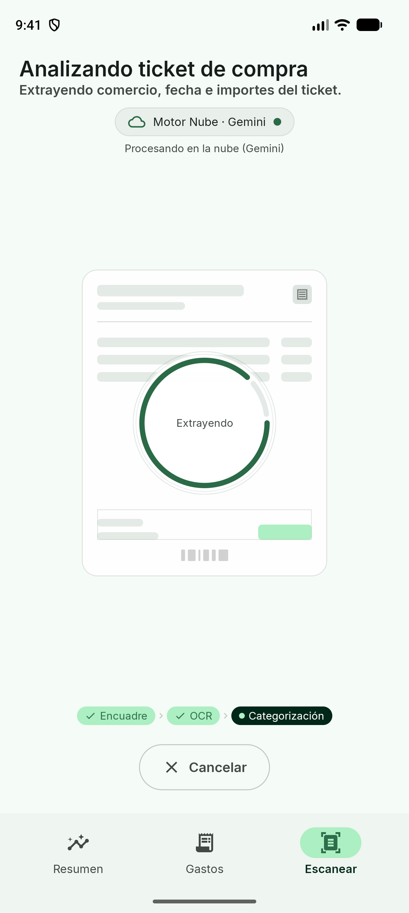
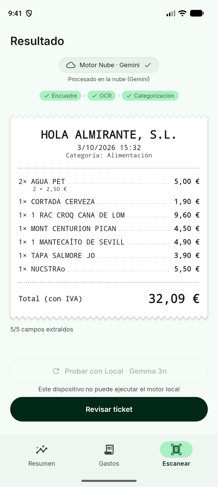
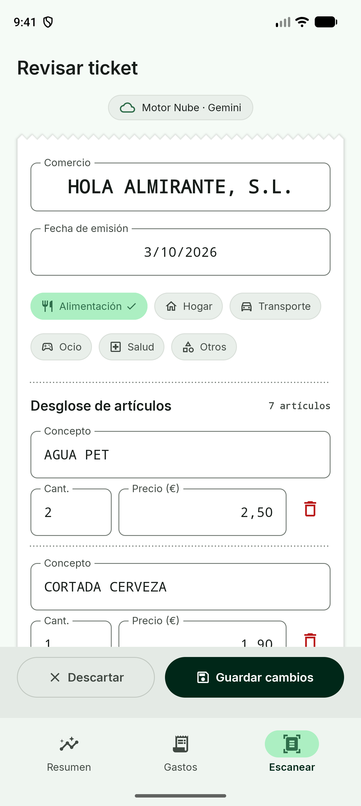
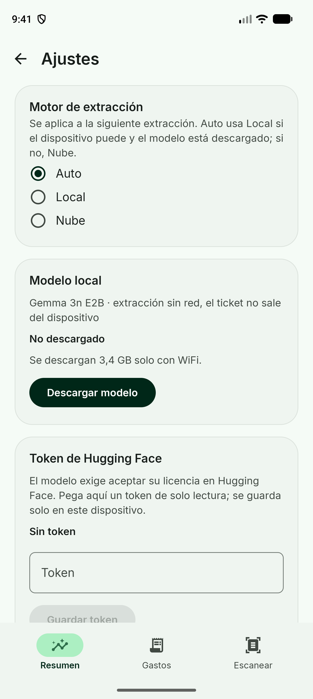
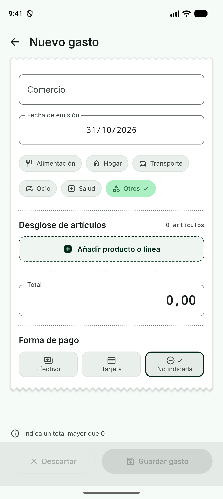

# Tally 🧾

Una aplicación Android nativa de control de gastos personales a partir de **fotos de tickets de compra**. Hace el OCR en el dispositivo y usa un modelo de lenguaje, **local (Gemma 3n) o en la nube (Gemini)**, para convertir el ticket en datos estructurados que el usuario revisa antes de guardar.

Sin cuentas, sin backend y sin sincronización: todos los datos viven en el dispositivo. Con el motor local, **el ticket nunca sale del móvil**.

## 📱 Características

- **Escaneo de tickets**: cámara con encuadre guiado o selección desde la galería (sin pedir permisos de medios)
- **OCR en el dispositivo**: ML Kit Text Recognition v2, sin red ni clave de API
- **Extracción con IA**: comercio, fecha, total con IVA, líneas, categoría y forma de pago
- **Doble motor**: Gemma 3n on-device o Gemini en la nube, elegidos por un router según el dispositivo
- **Motor siempre visible**: un badge indica qué motor ha procesado cada ticket, sin fallback oculto
- **Reintento con el otro motor**: si una extracción falla o sale mal, se reintenta con el mismo texto
- **Revisión obligatoria**: se pueden editar cabecera, líneas, categoría y forma de pago antes de guardar
- **Resumen por período**: Día, Semana, Mes o rango personalizado, con total, comparativa y donut por categoría
- **Listado de gastos**: agrupado por día, con filtro por forma de pago y detalle/borrado de cada ticket
- **Gasto manual**: alta rápida de gastos sin ticket
- **Descarga del modelo local**: desde Ajustes, reanudable, solo con WiFi y con aviso de espacio
- **Diseño Material 3**: adaptado a móvil y tablet, con soporte para tamaños de fuente grandes

## 🛠️ Tecnologías Utilizadas

### Core
- **Kotlin** - 100 % Kotlin, sin Java en el código fuente
- **Jetpack Compose** - UI declarativa, sin layouts XML
- **Material 3** - Sistema de diseño de Google
- **Clean Architecture + MVVM** - Arquitectura por capas con presentación MVVM
- **Hilt** - Inyección de dependencias
- **Coroutines + Flow** - Concurrencia y estado reactivo

### Inteligencia artificial
- **ML Kit Text Recognition v2** - OCR on-device (variante *bundled*)
- **MediaPipe LLM Inference** - Ejecución local de **Gemma 3n E2B** (int4, ~3,4 GB)
- **Firebase AI Logic** - Acceso a **Gemini** (`gemini-flash-lite-latest`) en la nube
- **Firebase App Check** - Protección del acceso al modelo en la nube
- **Kotlinx Serialization** - Parseo y validación del JSON devuelto por los modelos

### Persistencia
- **Room** - Única fuente de verdad, con DAOs que devuelven `Flow`
- **Migraciones explícitas** - Esquema versionado y probado, sin migraciones destructivas
- **WorkManager** - Descarga en segundo plano del modelo local

### Cámara y navegación
- **CameraX** - Captura de la foto del ticket
- **ExifInterface** - Corrección de orientación de las fotos
- **Navigation Compose** - Navegación con rutas tipadas en una sola `Activity`

### Testing
- **JUnit + Turbine** - Tests unitarios de casos de uso, repositorios y ViewModels
- **Compose UI Test + Espresso** - Tests instrumentados con Room en memoria y módulos Hilt sustituidos

### Build System
- **Gradle Version Catalogs** - Versiones centralizadas en `libs.versions.toml`
- **Build Logic** - Plugins de convención propios
- **Multi-Module Architecture** - Separación por capas y por pantallas

## 📋 Requisitos Previos

- Android Studio reciente compatible con AGP 9.2
- JDK 17 o superior para ejecutar Gradle (el código compila con target Java 11)
- Android SDK 36; nivel de API mínimo **26 (Android 8.0)**
- Para el **motor Nube**: un proyecto de Firebase con AI Logic activado
- Para el **motor Local**: un dispositivo con unos **10 GB de RAM** o más, ~4 GB libres y un token de Hugging Face con acceso a Gemma

## 🔧 Configuración del Proyecto

### 1. Clonar el repositorio
```bash
git clone https://github.com/robertomr99/Tally.git
cd Tally
```

### 2. Compilar y verificar
El proyecto compila **sin credenciales**: el plugin de Google Services solo se aplica si existe `app/google-services.json`.

```bash
./gradlew assembleDebug testDebugUnitTest
```

También puedes usar el script de verificación base del repositorio:

```bash
bash init.sh
```

### 3. (Opcional) Configurar el motor Nube
1. Crea un proyecto en [Firebase](https://console.firebase.google.com/) y añade una app Android con el paquete de Tally
2. Activa **Firebase AI Logic** con el backend Gemini Developer API
3. Descarga `google-services.json` y colócalo en `app/` (está en `.gitignore`)
4. En builds debug, registra el *debug token* de App Check que imprime la app en **App Check › Manage debug tokens**

> No hay ninguna clave de API dentro del APK ni en `BuildConfig`.

### 4. (Opcional) Configurar el motor Local
El modelo no viaja en el APK. Desde **Ajustes** en la app:
1. Pega tu token de Hugging Face (el modelo está sujeto a la licencia de Gemma)
2. Inicia la descarga de `gemma-3n-E2B-it-int4.litertlm` (solo WiFi, se reanuda si se corta)

El token se guarda en el almacenamiento privado de la app y no se incluye en copias de seguridad.

## 📱 Cómo usar la aplicación

1. **Escanear**: pulsa *Escanear*, encuadra el ticket con la cámara o elige una foto de la galería
2. **Procesado**: la app hace el OCR y extrae los datos; el badge muestra si ha usado el motor Local o Nube
3. **Revisar**: corrige lo que haga falta (comercio, fecha, total, líneas, categoría, forma de pago) y guarda
4. **Si algo falla**: reintenta con el otro motor o introduce los datos a mano
5. **Consultar**: en *Resumen* elige Día, Semana, Mes o un rango; en *Gastos* filtra por forma de pago y abre cualquier ticket
6. **Ajustes**: fuerza el motor (Auto, Local o Nube) y gestiona la descarga del modelo local

## 🏗️ Arquitectura

El proyecto sigue **Clean Architecture + MVVM**, es **single-activity** y está **modularizado por capas y por pantallas**:

### Estructura del proyecto:
```
Tally/
├── app/                      # Ensambla todo y define la navegación (NavHost)
├── build-logic/              # Plugins de convención de Gradle
├── domain/
│   ├── core/                 # Utilidades de dominio compartidas
│   └── expenses/             # Entidades, casos de uso e interfaces (TextEngine, OcrEngine...)
├── framework/
│   ├── database/             # Room, DAOs y almacenamiento de fotos
│   └── ai/                   # ML Kit, GemmaLocalEngine, GeminiCloudEngine, descarga del modelo
├── feature/
│   ├── common/               # Tema y componentes Compose compartidos
│   ├── resumen/              # Panel de gastos por período y categoría
│   ├── gastos/               # Listado, detalle y gasto manual
│   ├── escanear/             # Captura, procesado y revisión del ticket
│   └── ajustes/              # Motor preferido y descarga del modelo local
├── test/unit/                # Dobles de prueba compartidos
├── docs/                     # Discovery, ADRs, specs y evidencias
└── gradle/libs.versions.toml # Version Catalog
```

### Regla de dependencias:
```
app ─► feature:* ─► domain:*
 │         └─► common ◄─┘
 └──────► framework:* ───┘ (implementa interfaces de domain)
```

- **`domain` es Kotlin puro**: no conoce Android, MediaPipe ni Firebase
- **`framework` implementa interfaces de `domain`**, nunca al revés; sus implementaciones son `internal`
- **Los módulos `feature` no se conocen entre sí**: solo `:app` los conecta
- **Cada pantalla** tiene `XScreen`, `XViewModel` (expone `StateFlow`) y `XState` (estado visual)

### Pipeline de IA en dos etapas:
```
Cámara / Galería → foto normalizada y persistida
  → OcrEngine (ML Kit, on-device) → texto crudo
  → EngineRouter → TextEngine (Local: Gemma 3n | Nube: Gemini)
  → JSON validado por un parser común
  → Revisión humana → Room → Resumen / Gastos
```

Ambos motores reciben **el mismo texto, el mismo prompt y el mismo schema**, así que su comparación es justa. El razonamiento completo está en los ADR:

- [ADR 0001 - Doble motor con router](docs/adr/0001-doble-motor-con-router.md)
- [ADR 0002 - OCR en dos etapas con ML Kit](docs/adr/0002-ocr-en-dos-etapas-con-ml-kit.md)

### Política del router:
- **Auto** → Local si el dispositivo es capaz (≥ 10 GB de RAM) y el modelo está descargado; si no, Nube
- **Local forzado** → Local, o un error claro si no está disponible
- **Nube forzada** → Nube

## 🎨 Capturas de pantalla

<div align="center">

### Resumen, gastos y detalle

| Resumen del período | Listado de gastos | Detalle del ticket |
| :---: | :---: | :---: |
|  |  |  |

### Escaneo de un ticket

| Encuadre guiado | Procesado | Resultado |
| :---: | :---: | :---: |
|  |  |  |

### Revisión, ajustes y gasto manual

| Revisión antes de guardar | Ajustes | Gasto manual |
| :---: | :---: | :---: |
|  |  |  |

> En el ejemplo, el ticket real marca 35,30 € con impuestos y el modelo extrajo 32,09 € (la base imponible). Para eso está la revisión obligatoria antes de guardar.

</div>

## 🚀 Funcionalidades destacadas

### IA on-device
- Gemma 3n E2B ejecutándose con MediaPipe, sin red
- La carga del modelo nunca ocurre en el hilo principal
- La generación se corta en cuanto se cierra el objeto JSON, lo que reduce mucho la latencia
- Cancelación estructurada del procesado desde la UI

### Honestidad del resultado
- El motor usado se muestra y se guarda con cada ticket
- No hay porcentajes de confianza inventados: se muestra cuántos campos se han extraído
- Una respuesta malformada produce un error claro, nunca datos inventados
- Siempre hay salida: reintento con el otro motor o corrección manual

### Datos seguros en local
- La foto se guarda en el momento de la captura, así que sobrevive a un cierre inesperado
- Migraciones de Room probadas sobre base de datos real
- Sin telemetría remota: el registro de extracciones guarda solo metadatos y en local

## 📊 Resultados medidos

Sobre 4 tickets reales de comercios distintos, contrastados a mano contra el papel:

| Motor | Totales correctos | Tiempo de generación por ticket |
| --- | :---: | --- |
| Nube (Gemini Flash Lite) | 4/4 | unos 9 s |
| Local (Gemma 3n, Galaxy Tab S9+) | 2/4 | 26,8–41,2 s |

Aun así, **Auto prioriza Local**: privacidad, funcionamiento sin red e IA on-device. La revisión obligatoria y el reintento con el otro motor compensan los fallos.

## 🤖 Desarrollo asistido por IA

Tally se ha construido con agentes de IA dentro de un proceso con reglas y verificación independiente:

- **planner** escribe la spec de cada feature en `docs/specs/`
- **implementer** la implementa y se auto-verifica
- **validator** la revisa de forma independiente y devuelve `accept`, `revise` o `block`

Las reglas viven en el repositorio: [`AGENTS.md`](AGENTS.md), [`feature_list.json`](feature_list.json) (backlog con dependencias), [`PROGRESS.md`](PROGRESS.md) (diario con evidencia) y [`docs/evidence/`](docs/evidence/) (capturas, logs y medidas). Una feature no se da por buena por tener código escrito: necesita verificación ejecutada y evidencia registrada.

## 🧪 Testing

```bash
# Tests unitarios
./gradlew testDebugUnitTest

# Tests instrumentados (emulador o dispositivo conectado)
./gradlew connectedDebugAndroidTest
```

> ⚠️ Los tests instrumentados reinstalan la app y pueden borrar el modelo local descargado y el token de Hugging Face.

## 👨‍💻 Autor

**Roberto Muñoz**
- GitHub: [@robertomr99](https://github.com/robertomr99)
- Proyecto final del curso AI Expert

---

⭐ Si te gusta el proyecto, ¡dale una estrella en GitHub!
